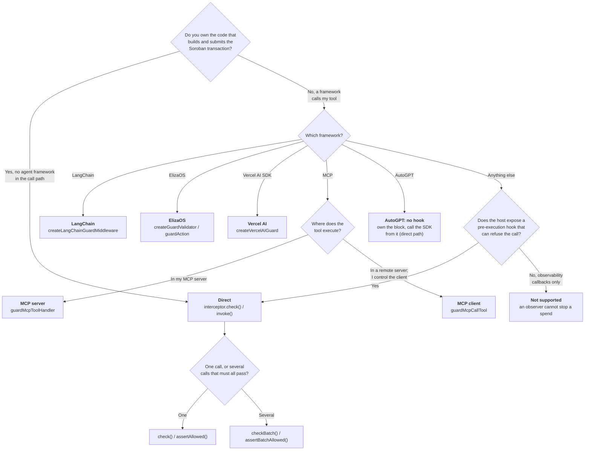

# Which integration should I use?

The SDK guards a fund-moving action **before** it executes. Which entry point you
use depends on where that action runs and what hook the host gives you. Answer
the questions in order. Each outcome names the API, its reference page, and a file
you can run.

## The questions

1. **Do you own the code that builds and submits the transaction?** If no agent
   framework sits between the model and your submit call, you need no adapter:
   use the [direct path](#direct-path). Adapters exist only to reach a
   pre-execution point inside someone else's loop.
2. **Which framework calls your tool?** Each supported framework has exactly one
   adapter, built on a hook verified in
   [`integration-hooks.md`](integration-hooks.md).
3. **MCP only: where does the tool execute?** If your process is the MCP
   *server*, guard the registered handler. If the tool runs in someone else's
   server and you control the *client*, guard `callTool` so a refused request
   never leaves your process. You can use both.
4. **Unlisted framework: does it expose a hook that can refuse the call before it
   runs?** If it does, call the [direct path](#direct-path) from that hook and
   act on the verdict. If it only offers callbacks that observe a call that is
   already running, it cannot be guarded. See [Not supported](#not-supported-stated-plainly).
5. **Single or batch?** Every adapter and the direct path accept either one
   mapped `ContractCall` or an ordered list of them. With a list, the action runs
   only if **every** call is admissible (`checkBatch`).

## Outcomes

| Outcome | Use | Reference | Runnable example |
| --- | --- | --- | --- |
| Direct (own the submit path) | `PreFlightInterceptor.check()` / `assertAllowed()`, or `invoke()` to pre-flight, sign and submit in one call | [Interceptor](api/interceptor.md), [Invoke pipeline](api/invoke-pipeline.md), [Running an agent 24/7](agent-runtime.md) | [`examples/quickstart.ts`](../examples/quickstart.ts), [`examples/agent-runtime.ts`](../examples/agent-runtime.ts) |
| Direct, several calls | `checkBatch()` / `assertBatchAllowed()` | [Interceptor: `checkBatch`](api/interceptor.md) | No standalone example file. The runnable reference is the `PreFlightInterceptor.checkBatch()` suite in [`tests/unit/preflight.test.ts`](../tests/unit/preflight.test.ts) (`npm test`) |
| LangChain | `createLangChainGuardMiddleware` (`wrap_tool_call`) | [Framework adapters: LangChain](api/framework-adapters.md#langchain), [guide](examples/langchain.md) | [`examples/langchain.ts`](../examples/langchain.ts) |
| ElizaOS | `createGuardValidator` / `guardAction` (`Action.validate`) | [Framework adapters: ElizaOS](api/framework-adapters.md#elizaos), [guide](examples/elizaos.md) | [`examples/elizaos.ts`](../examples/elizaos.ts) |
| Vercel AI SDK | `createVercelAIGuard` (tool `execute`) | [Framework adapters: Vercel AI SDK](api/framework-adapters.md#vercel-ai-sdk) | No standalone example file yet. The runnable reference is [`tests/unit/vercelai-adapter.test.ts`](../tests/unit/vercelai-adapter.test.ts) (`npm test`) |
| MCP server | `guardMcpToolHandler` around the registered handler | [MCP guide](examples/mcp.md), [hooks §4](integration-hooks.md#4-mcp-model-context-protocol--registered-tool-handler--client-calltool) | [`examples/mcp-server.ts`](../examples/mcp-server.ts) (a full server), [`examples/mcp.ts`](../examples/mcp.ts) (the wrapper on its own) |
| MCP client | `guardMcpCallTool` around `Client.callTool` | [MCP guide](examples/mcp.md) | [`examples/mcp.ts`](../examples/mcp.ts) |
| AutoGPT | No adapter. Write the block that performs the action and call the direct path from it, or upstream a hook | [hooks §3](integration-hooks.md#3-autogpt--no-third-party-pre-execution-blocking-hook) | The direct-path examples above |
| Browser / dashboard (read-only) | Root entry only, no signing | [Runtime support](runtime-support.md) | [`examples/browser/`](../examples/browser/README.md) |

## Direct path

Use the interceptor or `invoke()` directly, with no adapter, when:

- your own code builds the `ContractCall` and submits it, as in a backend
  service, a cron job or a custom agent loop;
- the framework has no adapter, but you can call a function and act on its
  result before the action runs (question 4);
- you are writing the action itself, as with an AutoGPT block you own.

`check()` returns the verdict and you decide what to do with it. `invoke()` runs
the same pre-flight and then signs and submits only on an `admissible` verdict.
Either way the rule is the one every adapter follows: **only `admissible` lets
the action run**. `blocked` and `undetermined` both stop it.

## Not supported, stated plainly

- **AutoGPT.** It exposes no third-party pre-execution blocking hook, so there is
  no adapter. The SDK will not ship one built on a guessed interface. The
  workarounds in [hooks §3](integration-hooks.md#3-autogpt--no-third-party-pre-execution-blocking-hook)
  protect only actions that go through code you own.
- **Observability-only hosts.** A framework that only reports tool calls after
  they start (tracing callbacks, log hooks) can watch a spend but not stop one.
  The SDK does not treat that as guarding.
- **Frameworks not listed here.** There is no adapter for them. Use the direct
  path from whatever pre-execution point they give you, or open an issue with the
  hook's source location so it can be verified for
  [`integration-hooks.md`](integration-hooks.md).
